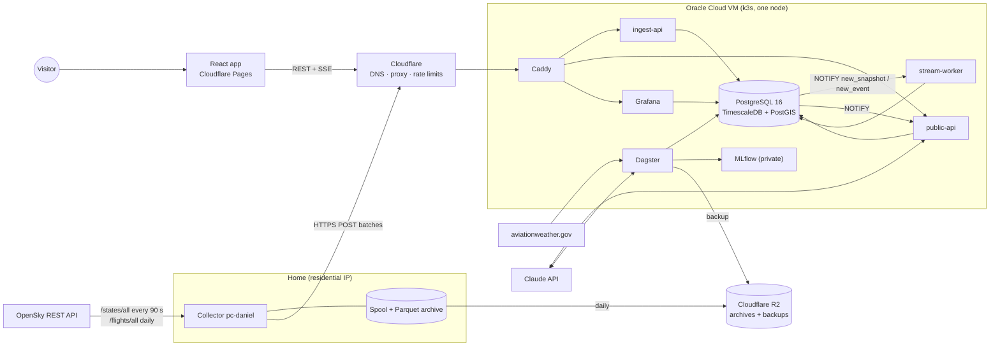

# 01 · Architecture

## System overview



## Components

| Component | Runs on | Responsibility | Tech |
|---|---|---|---|
| **collector** | Raspberry Pi at home, in Docker (a Windows PC until 2026-11-07) | Poll OpenSky on a fixed grid, spool every response, upload, archive to Parquet and R2 | Python 3.12, httpx |
| **ingest-api** | VM (k3s Deployment, 1 replica) | Authenticate the collector, validate, normalise, compute H3, insert idempotently, record batches, `NOTIFY` live snapshots | FastAPI, psycopg 3 |
| **db** | VM (k3s StatefulSet, local volume) | System of record | PostgreSQL 16, TimescaleDB ≥ 2.19, PostGIS |
| **stream-worker** | VM (k3s Deployment, 1 replica) | Per-snapshot work on live snapshots: squawk and go-around events, ETA inference | Python, `LISTEN/NOTIFY` |
| **orchestrator** | VM (3 k3s Deployments) | Scheduled, windowed jobs ([04](04-pipelines.md#p4--orchestrated-jobs)) | Dagster (webserver, daemon, code location) |
| **public-api** | VM (k3s Deployment, 1–3 replicas by HPA) | Read API, SSE stream, chat | FastAPI |
| **mlflow** | VM | Experiment tracking and model registry; private | MLflow, Postgres backend, `mlflow-artifacts` volume |
| **grafana** | VM (k3s Deployment, 1 replica) | Ops, data-quality and model dashboards; shared publicly as externally shared dashboards | Grafana OSS |
| **web** | Cloudflare Pages | Single-page app | React 19, TypeScript, Vite, MapLibre GL, deck.gl |
| **caddy** | VM | TLS termination with the Cloudflare Origin CA certificate, routing by hostname | Caddy 2 |

## Why the collector runs at home

OpenSky blocks or throttles data-centre IPs. The collector runs on a residential connection and **pushes** to the server; the server never calls OpenSky ([ADR-0001](adr/0001-home-collectors-push-to-cloud.md)).

One collector polls on a 90 s grid, so the map refreshes every 90 s ([D4](11-tasks.md#decided-while-building)). It computes its slots from its NTP-synced clock.

## Hosting

Oracle Cloud Infrastructure **Always Free**, region `eu-frankfurt-1` ([ADR-0004](adr/0004-hosting-oracle-free-tier.md)):
- `VM.Standard.A1.Flex`, 2 OCPU (Ampere ARM), 12 GB RAM, 200 GB block storage, Ubuntu 24.04 arm64.
- The tenancy is upgraded to Pay As You Go with a budget alert at €1, so capacity requests succeed more often and the VM is not reclaimed as idle. Usage stays inside the free limits.
- Oracle cut the Always Free A1 allowance to 2 OCPU and 12 GB per tenancy (checked 2026-11-22), and the 200 GB boot volume uses the whole block-storage allowance. This VM is all the free capacity there is: a second node in this tenancy would be billed ([ADR-0005](adr/0005-single-node-k3s.md)).
- The services run on **single-node k3s** ([ADR-0005](adr/0005-single-node-k3s.md)). The Raspberry Pi is the architecture's edge node but not a cluster member: it runs the collector in Docker.
- **Fallback:** if no A1 capacity is obtained by the end of week 1, use a Contabo Cloud VPS 10 (4 vCPU, 8 GB, 75 GB NVMe, amd64, about €5/month). Nothing else changes; images are multi-arch.

```
VM (node label airspace/role=server)
├── tailscale (host)          admin access; `tailscale serve` maps tailnet ports to NodePorts
├── docker (host)             builds our images only (infra/k8s-apply.sh)
└── k3s v1.36, namespace airspace (infra/kustomization.yaml, infra/k8s/)
    ├── db                    StatefulSet; headless Service `db`, no NodePort; /srv/airspace/db-data
    ├── migrate               Job, run by k8s-apply.sh before every rollout: dbmate up
    ├── ingest-api            Deployment ×1   NodePort 127.0.0.1:30800 → tailnet :8000 (D3)
    ├── public-api            Deployment 1–3 (HPA, CPU 70%)   127.0.0.1:30801 → tailnet :8001 (D3)
    ├── stream-worker         Deployment ×1, Recreate (single consumer)
    ├── dagster-code          Deployment ×1, Recreate; runs execute here; /srv/airspace/dagster-storage
    ├── dagster-webserver     Deployment ×1   127.0.0.1:30300 → tailnet :3000
    ├── dagster-daemon        Deployment ×1, Recreate (one daemon per instance)
    ├── mlflow                (M4.5)          → tailnet :5000
    ├── grafana               Deployment ×1, Recreate   127.0.0.1:30301 → tailnet :3001 (D12); /srv/airspace/grafana-data
    └── caddy                 (before a public launch) :443 → api.<domain>, ingest.<domain>, grafana.<domain>
```

Every workload has CPU and memory requests, a memory limit, and readiness and liveness probes where it serves a port. NodePorts listen on `127.0.0.1` only (k3s `nodeport-addresses`); Traefik and ServiceLB are disabled, so nothing in the cluster is reachable from the internet. Secrets come from `infra/.env`, synced into the `airspace-env` Secret on every deploy, and k3s encrypts Secrets at rest.

**Scaling.** One node means no failover: if the VM is down, the services are down, and the Pi spools until it is back. More capacity means joining agent nodes with the server's token over Tailscale; the stateless Deployments spread without changes, and the database is the only workload pinned to a node. Compose (`infra/compose.yml`) remains the local-dev and CI definition of the same stack.

## Deployment

- **Images:** CI (`ci.yml`) builds every image for `linux/amd64` and `linux/arm64` with Buildx to prove it builds. The VM builds its own images from the checkout and imports them into k3s's containerd, tagged by image ID, so an unchanged image does not restart its pods. Pushing to GHCR (`ghcr.io/<org>/airspace-<service>`) comes when a second node needs to pull them.
- **The VM runs a git checkout of `main`** in `/home/ubuntu/airspace` (since 2026-11-07), with `infra/.env` beside it (not in git).
- **Setup, once:** `infra/k3s-install.sh` installs the pinned k3s, allows the pod and service ranges through Oracle's default iptables rules, labels the node and makes the kubeconfig readable by the deploying user's group. `infra/k3s-cutover.sh` stops Compose, moves the Docker volumes to `/srv/airspace/`, deploys, and points `tailscale serve` at the NodePorts; `--rollback` reverses it.
- **Deploy** (`deploy.yml`, after `ci.yml` passes on `main`, or started by hand):
  1. The runner joins the tailnet with `tailscale/github-action` as an ephemeral `tag:ci` node (OAuth client from Actions secrets).
  2. It SSHes to the VM with a deploy key that can only run `infra/deploy.sh` (a forced command in `authorized_keys`), checking the VM's pinned host key.
  3. `deploy.sh` refuses to run over local edits and fast-forwards to `origin/main`. `infra/k8s-apply.sh` then builds our images, imports the changed ones, syncs the `airspace-env` Secret and the migrations ConfigMap, applies the database, runs the `migrate` Job, applies the rest of the manifests and waits for every rollout.
  - A team member can run `infra/deploy.sh` on the VM by hand; it does the same. CI's `k8s` job runs the same `k3s-install.sh` and `k8s-apply.sh` on a throwaway k3s for every PR.
  - Migrations run **before** the new code starts, so every migration must work with the code that is still running (add columns and tables first, remove them in a later release).
  - Collector keys: `infra/ingest-admin.sh add-collector --id <id> --owner <name>` runs the admin CLI in a throwaway pod.
- **Frontend:** Cloudflare Pages builds `web/` on every push; PRs get preview URLs.

## Networking and security

**While the project is private ([D3](11-tasks.md#decided-while-building)):** no inbound ports are open to the internet. The collector uploads to ingest-api over the tailnet, using `tailscale serve` as for Dagster, and Cloudflare, Caddy and port 443 are not set up. The table below is the target state, and every item in it is in place before a public URL is shared.

| Concern | Decision |
|---|---|
| DNS and edge | `<domain>` on Cloudflare. `api`, `ingest`, `grafana` are proxied records; SSL mode Full (strict) |
| TLS at the origin | Caddy uses a Cloudflare Origin CA certificate (installed once, not in git) |
| Firewall | OCI security list: TCP 443 inbound only from Cloudflare's published IP ranges. Port 22 is closed to the internet; SSH only over Tailscale |
| Collector auth | A random key, sent as `Authorization: Bearer`, stored only as an argon2id hash in `ops.collectors`. Created with `python -m ingest.admin add-collector`, which prints the key once |
| DB exposure | No NodePort. Admin access: SSH over Tailscale, then `kubectl -n airspace exec -it db-0 -- psql -U postgres -d airspace` |
| DB roles | Least privilege per service ([03](03-data-model.md#roles)) |
| Rate limits | Cloudflare rate-limiting rule on `api.<domain>/api/v1/*`: 60 requests per 10 s per IP. Chat limits in public-api ([05](05-api-contract.md#post-chat)). Anthropic console spend limit $40/month |
| Grafana | Anonymous access disabled. Public dashboards are *externally shared dashboards*, which run only their own saved queries. `grafana_reader` sees views without key hashes and has a 10 s statement timeout |
| Dagster, MLflow | Not routed by Caddy; reachable only on the tailnet |
| Secrets | VM `.env` (not in git): DB role passwords (including `BACKUP_PASSWORD`), Anthropic key, Grafana admin password, R2 credentials (`R2_ACCOUNT_ID`, `R2_ACCESS_KEY_ID`, `R2_SECRET_ACCESS_KEY`). GitHub Actions secrets: `TS_OAUTH_CLIENT_ID`, `TS_OAUTH_SECRET`, `DEPLOY_SSH_KEY`, and later the Anthropic key for the eval. The collector's `.env`: its OpenSky client, ingest key and R2 credentials |

## Backups

Daily `backup` Dagster job ([04](04-pipelines.md#backup)) to Cloudflare R2 `airspace-backup/`, 14 days kept, as the read-only `backup` role ([D8](11-tasks.md#decided-while-building)):
- `airspace` without the raw hypertables' chunk data (raw data is restored from the archives) or the continuous aggregates' data (recomputed from raw, [D13](11-tasks.md#decided-while-building)),
- `dagster` and `mlflow`,
- the `mlflow-artifacts` volume.

The collector copies its Parquet archives to R2 `airspace-archive/` daily, so raw data survives the loss of the collector device. Backups and archives together stay under 8 GB, inside R2's free tier: the backup job deletes the oldest archive files above that ([D7](11-tasks.md#decided-while-building)).

## Sizing

| Item | Estimate | Basis |
|---|---|---|
| State vectors | ~9.5M rows/day at 24/7 | 960 snapshots × 9,886 aircraft on average (measured 2026-10-29 to 11-03; 5,700–13,600 per snapshot over the day). pc-daniel, off overnight, stores 5–6M rows/day |
| Raw size | ~2.3 GB/day uncompressed, ~0.65 GB/day compressed | 244 bytes/row with 2 indexes; 69 bytes/row compressed, 2.9× (both measured; compression on 5 days of data, 2026-11-05) |
| Raw at 90 days | ~60–65 GB | 2 uncompressed days + 88 compressed days |
| Flight lists | ~52k rows/day | Measured over 6 days |
| Parquet archive | ~185 MB/day (~21 bytes/row); ~5.5 GB for the Pi's 30 days | Measured on 2026-11-12: 8.63M state vectors in 183 MB (zstd, sorted by aircraft within each hour) and 18k flight-list rows under 1 MB; 336 MB of gzipped JSON before. Compacting the day took 3 min and 363 MB of RAM on the Pi |
| Everything else | < 15 GB | predictions with retention, flight lists, aggregates |
| RAM | ~8.5 GB steady, ~10.5 GB during training | Postgres 4 GB, Dagster 1.5 GB, MLflow 0.5 GB, Grafana 0.3 GB, services 1.5 GB, k3s ~0.6 GB. Measured 2026-11-22 under Compose: 2.4 GB for everything built so far |

Rows, bytes per row, compression and the Parquet sizes are measured; "everything else" is still an estimate.

## Cost (Level 1, per month, excl. VAT)

| Item | Cost |
|---|---|
| Oracle VM | €0 (fallback Contabo: ~€5) |
| Cloudflare R2 (archives + backups, capped at 8 GB, [D7](11-tasks.md#decided-while-building)) | €0 |
| Claude API (Haiku; briefing ~$1.50, chat ~$0.005/question, capped) | $2–8 typical, ≤ $40 hard limit |
| Domain | ~€1 |
| Cloudflare DNS/Pages, GitHub, GHCR, Tailscale | €0 |
| Electricity for the collector (estimate) | < €2 on the Raspberry Pi; €4–25 for a home PC at 50–100 W if left on |
| **Total** | **€5–15 plus electricity** |

## Later: Level 2 (out of scope)

Our own ADS-B receiver is not part of the build. [ADR-0002](adr/0002-source-agnostic-ingestion.md) records what it would need.
