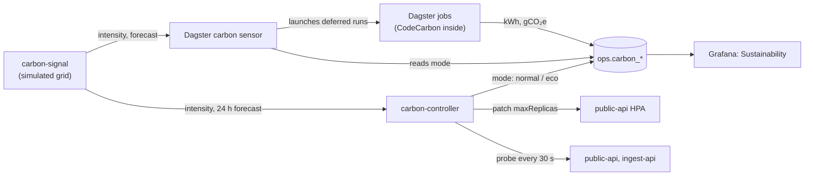

# ADR-0006 · Carbon-aware operations with a simulated signal

**Status:** proposed · 2026-11-23 · builds on [ADR-0005](0005-single-node-k3s.md) and [D15](../11-tasks.md#decided-while-building)

## Context
- The course feedback asked how the dynamic carbon-aware behaviour will be demonstrated, and the course grades automatic reactions to a simulated carbon signal while the system keeps its SLOs, with emissions measured (CodeCarbon is the named tool).
- The server is one k3s node on a free Oracle VM ([ADR-0005](0005-single-node-k3s.md)). There is no second node or region to move work to, so the system can only act in time (run heavy work later) and in intensity (run services leaner). This was decided in [D15](../11-tasks.md#decided-while-building).
- Two paths must never slow down: ingest (the Pi uploads every 90 s, [04](../04-pipelines.md#p2--ingest)) and the live map (public-api, [05](../05-api-contract.md)). Everything else has slack: the daily and weekly jobs ([04](../04-pipelines.md#p4--orchestrated-jobs), [06](../06-ml.md#training-schedule)) only need to finish before a deadline.
- The VM is an ARM Ampere A1 with no RAPL or other power counters, so energy can only be estimated.

## Decision
Four parts: a simulated signal, a controller that reacts to it, measurement of what each job emitted, and a dashboard that shows it.

### 1. Signal: `carbon-signal` service
- A small FastAPI Deployment in the `airspace` namespace. It plays the outside world (the grid operator), so nothing else computes intensity.
- **Curve:** a synthetic Central European day in gCO₂e/kWh: lowest around midday (solar), highest in the early evening, between about 120 and 450. Seeded noise is derived from the timestamp, so the same instant always returns the same value: replays and tests are deterministic.
- **Override for demos:** `PUT /v1/override {"intensity_g_kwh": 420, "until": "..."}` pins the value; `DELETE /v1/override` returns to the curve. Readings report `source: curve | override`.
- **Time scale:** `SIGNAL_TIME_SCALE` (default 1) speeds up the simulated clock for a demo, for example 60 for one simulated day in 24 minutes. Production runs at 1.
- **API:** `GET /v1/intensity?at=` and `GET /v1/forecast?hours=24` (hourly points). Cluster-internal only: no NodePort.

### 2. Controller: Dagster sensor for jobs, `carbon-controller` pod for services
- **Classes:** *green* below 200, *dirty* above 350, *normal* in between. To avoid flapping, a class must hold for 10 minutes before the mode changes.
- **Deferrable jobs (Dagster sensor).** Each heavy job keeps its nominal schedule tick and its window, but gets a deadline:

  | Job | Nominal tick | Deadline |
  |---|---|---|
  | `backup` | daily 04:00 | +12 h |
  | `baseline_recompute` | daily 02:00 | +12 h |
  | `routes_refresh` | daily 08:30 | +12 h |
  | `train_eta`, `train_destination` | weekly, Sunday | +48 h |

  At the tick, the run is queued instead of launched. The sensor (every 5 min) launches it when the current hour is the lowest-intensity hour left in the forecast before the deadline (or the class is *green*), and always launches it when only 2 h are left before the deadline. The window comes from the nominal tick, so a deferred run produces exactly what an on-time run would have: the jobs stay idempotent.
- **Never deferred:** `collector_gap_check`, `flights_sessionizer`, `destination_inference`, `anomaly_scoring`, `metar_fetch`, `agg_backfill_refresh`, and the stream-worker. They are either the live path or feed it.
- **Eco profile (`carbon-controller` pod).** A small Deployment with its own ServiceAccount. RBAC allows only `get` and `patch` on the HorizontalPodAutoscaler named `public-api`. In *dirty* mode it:
  - caps public-api autoscaling at 1 replica instead of 3;
  - writes `mode = eco` to `ops.carbon_mode`. The Dagster schedules for non-urgent work read it and run less often: `llm_briefing` every 60 min instead of 30, `dq_checks` every 3 h instead of hourly.
  
  In *normal* or *green* mode it restores the defaults. Ingest-api and the stream-worker are never touched.
- **SLO guardrail.** The controller probes the live path every 30 s and records the results. If the public-api latency SLO is breached while in eco mode, it lifts the replica cap at once and records `reason = slo_guardrail`. The system stays in eco mode for the schedules.

### 3. SLOs
Measured by the controller's probes. They are part of the system's definition, not only of the carbon feature:

| SLO | Target | Measured as |
|---|---|---|
| Ingest available | ≥ 99.5 % of 30 s probes of `ingest-api /healthz` succeed, per day | probe |
| Live map fresh | `last_snapshot_age_s` ≤ 180 s in ≥ 99 % of probes, per day, excluding minutes inside a `collector_gap` event (the Pi or OpenSky, not the server) | `public-api /api/v1/health` |
| Live map fast | p95 latency of `GET /api/v1/live/snapshot` ≤ 500 ms per 15 min | probe |

The carbon feature succeeds only if these hold equally well in eco mode and in normal mode.

### 4. Measurement: CodeCarbon energy × our signal
- Every Dagster job runs inside a CodeCarbon `OfflineEmissionsTracker`, which estimates energy (kWh) from CPU load and memory. On the ARM VM it has no power counters, so it uses its CPU-power model. These are estimates, and the dashboard says so.
- gCO₂e = estimated kWh × the signal's intensity at run time. CodeCarbon's own country intensity is not used, so the emissions match the signal the controller acted on.
- For a deferred run, the intensity at its nominal tick is stored too, so the dashboard shows the gCO₂e avoided by waiting.
- Services are not wrapped in CodeCarbon. Their share is estimated from pod CPU (metrics-server) × the same watts-per-core figure CodeCarbon uses for this CPU, every 5 min.

### Data and interfaces (detailed in [03](../03-data-model.md) and [04](../04-pipelines.md) when built)
- `ops.carbon_readings (ts, intensity_g_kwh, source)`: what the system saw, every 5 min.
- `ops.carbon_mode (since, mode, reason)`: one row per mode change.
- `ops.slo_probes (ts, slo, ok, value)`: the controller's probe results.
- `ops.job_runs` gains `energy_kwh`, `intensity_g_kwh`, `gco2e`, `nominal_at`, `nominal_intensity_g_kwh`.
- Grafana *Sustainability* dashboard: signal and forecast, mode timeline, deferred runs (nominal vs actual start), gCO₂e per job and avoided, SLO compliance per mode.

### Demonstration
1. With the dashboard open, `PUT /v1/override` sets 420 (*dirty*). Within about 10 minutes the mode turns *eco*: the HPA's max replicas drops to 1, and the briefing cadence changes. A `backup` triggered by hand is queued, not run.
2. A load test on public-api while in eco mode shows the guardrail: if p95 latency passes 500 ms, the cap lifts.
3. `PUT /v1/override` sets 150 (*green*). The queued run starts, and its row shows the gCO₂e avoided by waiting.
4. With `SIGNAL_TIME_SCALE=60` on a demo deploy, a full simulated day shows the daily jobs moving to midday.

## Consequences
- Carbon-aware behaviour is visible and testable without any external account or data licence. The signal is openly synthetic, so absolute gCO₂e figures are illustrative. What the system demonstrates is the *mechanism* and the *relative* savings.
- Three new moving parts (`carbon-signal`, `carbon-controller`, the Dagster sensor), two small Deployments (about 50m CPU and 100 MiB each), and four table changes. Each part can fail safe: if the signal is unreachable, the sensor launches runs at their deadline and the controller stays in normal mode.
- The controller is the only workload with write access to the Kubernetes API, scoped to one HPA. dagster-code keeps no cluster permissions.
- Energy figures are estimates from CPU load (no power counters on the A1 VM). The method is the same for every run, so comparisons between runs and modes hold even if the absolute values don't.
- The SLOs and their probes are useful on their own: they are the first service-level measurements of the live path.
- Alternatives considered:
  - **Replay of real grid data:** more realistic, but needs a dataset with a usable licence. The synthetic curve can be swapped for a replay later behind the same API.
  - **Live intensity API (Electricity Maps, WattTime):** needs an account and a key, and the course asks for a simulated signal.
  - **Lighter LLM model in eco mode:** a real saving, but in Track B's area. Left as an option for later.
  - **Defer jobs only, no eco profile:** simpler, but services would show no automatic change.
  - **Own CPU-time model instead of CodeCarbon:** no extra dependency, but the course names CodeCarbon, and its CPU model is documented.
  - **Kepler (eBPF energy per pod):** heavy for a 2-core VM, and without power counters on ARM it would also be an estimate.
  - **Everything in Dagster:** one place, but dagster-code would need Kubernetes write access.
  - **KEDA:** a standard autoscaler, but an extra operator on a small VM, and it has no notion of job deadlines.
